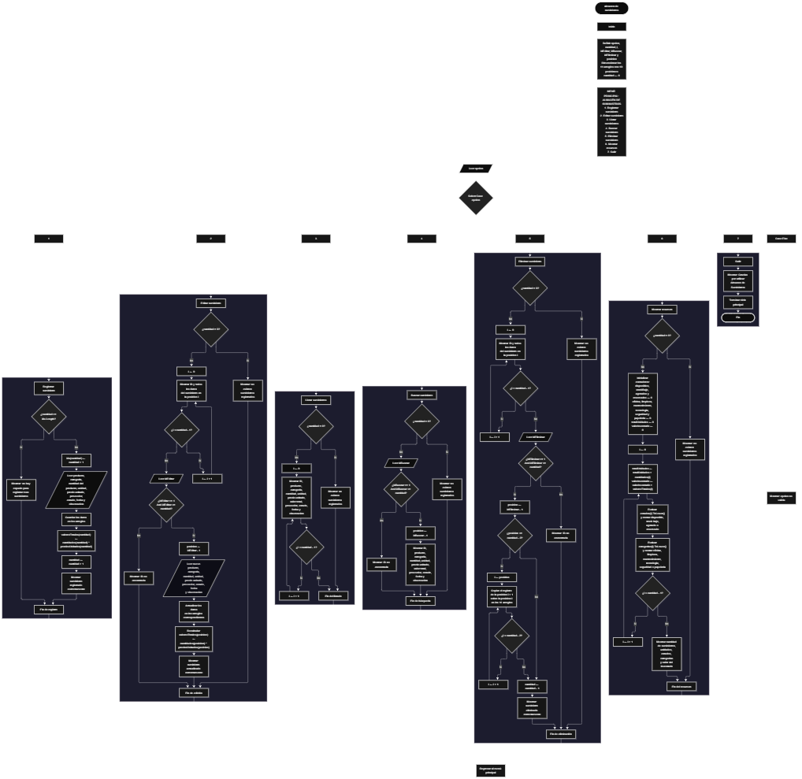

Este proyecto, llamado <b>almacén de suministros</b>, fue desarrollado en <b>visual basic .net</b> como un ejercicio práctico para fortalecer la lógica de programación mediante la creación de un sistema de gestión de suministros desde la consola. El programa cuenta con un menú principal de siete opciones que permite <b>registrar, editar, eliminar, buscar, listar y consultar un resumen</b> de los suministros almacenados. Cada suministro contiene información como el producto, la categoría, la cantidad, la unidad, el precio unitario, el valor total, el proveedor, el estado, la fecha y las observaciones, utilizando arreglos con una capacidad máxima de <b>10 suministros durante la ejecución</b>. Durante su desarrollo se aplicaron conceptos fundamentales de programación, como variables, arreglos, estructuras condicionales, ciclos repetitivos y estructuras de selección, además de operaciones aritméticas, acumuladores, contadores y procesos para buscar, modificar, eliminar y organizar registros. Este proyecto permite poner en práctica los conocimientos adquiridos en Visual Basic .NET y sirve como base para desarrollar sistemas de gestión de inventarios más avanzados utilizando otros lenguajes y tecnologías.

<h2 align="center">⚙️ Funcionamiento del menú principal</h2>

### ➕ Registrar suministro

La opción <b>1) registrar suministro</b> permite agregar un nuevo suministro al almacén. Antes de realizar el registro, el sistema comprueba que la cantidad de suministros almacenados sea menor que la capacidad de los arreglos, utilizando la condición <b>cantidad &lt; ids.Length</b>. Si existe espacio disponible, asigna un identificador mediante la expresión <b>cantidad + 1</b> y solicita los datos del producto: <b>producto, categoría, cantidad, unidad, precio unitario, proveedor, estado, fecha y observación</b>. Los datos se almacenan en la posición correspondiente de sus respectivos arreglos. Después, calcula el valor total del suministro mediante la operación <b>cantidades(cantidad) * preciosUnitarios(cantidad)</b> y aumenta la variable <b>cantidad</b> en uno. Finalmente, muestra el mensaje <b>"Suministro registrado correctamente."</b>. Si se alcanza la capacidad máxima de 10 registros, presenta el mensaje <b>"No hay espacio para registrar mas suministros."</b>, impidiendo agregar otro suministro.

### ✏️ Editar suministro

La opción <b>2) editar suministro</b> permite modificar la información de un suministro registrado. Primero, el programa comprueba si existen suministros almacenados mediante la condición <b>cantidad = 0</b>. Si no hay registros, muestra el mensaje <b>"No existen suministros registrados."</b>. En caso contrario, utiliza un ciclo <b>For</b> para recorrer los arreglos y mostrar los datos de todos los suministros registrados, incluyendo su ID, producto, categoría, cantidad, unidad, precio unitario, valor total, proveedor, estado, fecha y observación. Después, solicita el ID del suministro que se desea editar y comprueba que esté dentro del rango permitido mediante la condición <b>idEditar &gt;= 1 And idEditar &lt;= cantidad</b>. Si la selección es válida, calcula la posición mediante <b>idEditar - 1</b> y solicita los nuevos datos del suministro, actualizando directamente los valores de los arreglos correspondientes. También vuelve a calcular el valor total utilizando la nueva cantidad y el nuevo precio unitario. Finalmente, presenta el mensaje <b>"Suministro actualizado correctamente."</b>. Si el ID introducido no está dentro del rango permitido, muestra el mensaje <b>"ID no encontrada."</b>.

### 📋 Listar suministros

La opción <b>3) listar suministros</b> permite visualizar todos los suministros registrados actualmente en el almacén. Antes de mostrar la información, el programa comprueba si la variable <b>cantidad</b> es igual a cero. Si no existen registros, presenta el mensaje <b>"No existen suministros registrados."</b>. Si hay suministros disponibles, utiliza un ciclo <b>For</b> para recorrer los arreglos desde la primera posición hasta la última posición ocupada, mediante el límite <b>cantidad - 1</b>. Durante el recorrido, muestra el ID, producto, categoría, cantidad, unidad, precio unitario, valor total, proveedor, estado, fecha y observación de cada suministro. Esta función facilita consultar los registros existentes sin necesidad de buscar cada suministro individualmente.

### 🔎 Buscar suministro

La opción <b>4) buscar suministro</b> permite localizar un suministro mediante su identificador. Primero, el programa comprueba si existen suministros registrados. Si el almacén está vacío, muestra el mensaje <b>"No existen suministros registrados."</b>. En caso contrario, solicita el ID del suministro que se desea buscar y verifica que esté dentro del rango permitido mediante la condición <b>idBuscar &gt;= 1 And idBuscar &lt;= cantidad</b>. Si el ID es válido, calcula la posición correspondiente utilizando <b>idBuscar - 1</b> y muestra toda la información del suministro: <b>ID, producto, categoría, cantidad, unidad, precio unitario, valor total, proveedor, estado, fecha y observación</b>. Si el identificador introducido no está dentro del rango permitido, presenta el mensaje <b>"ID no encontrada."</b>.

### 🗑️ Eliminar suministro

La opción <b>5) eliminar suministro</b> permite eliminar un suministro registrado mediante su identificador. Antes de comenzar, el programa comprueba que existan suministros almacenados. Si no hay registros, muestra el mensaje <b>"No existen suministros registrados."</b>. Si existen suministros disponibles, presenta una lista con toda su información utilizando un ciclo <b>For</b>. Después, solicita el ID del suministro que se desea eliminar y verifica que esté dentro del rango permitido mediante la condición <b>idEliminar &gt;= 1 And idEliminar &lt;= cantidad</b>. Si el identificador es válido, calcula la posición correspondiente mediante <b>idEliminar - 1</b> e inicia el proceso de eliminación. Para mantener organizados los registros, utiliza otro ciclo <b>For</b>, controlado por la variable <b>i</b>, que desplaza una posición hacia la izquierda los datos de los suministros posteriores en los once arreglos: <b>ids, productos, categorias, cantidades, unidades, preciosUnitarios, valoresTotales, proveedores, estados, fechas y observaciones</b>. Posteriormente, disminuye la variable <b>cantidad</b> en uno y muestra el mensaje <b>"Suministro eliminado correctamente."</b>. Si el identificador introducido no está dentro del rango permitido, presenta el mensaje <b>"ID no encontrada."</b>.

### 📊 Mostrar resumen

La opción <b>6) mostrar resumen</b> permite consultar un resumen general de los suministros registrados en el almacén. Primero, el programa comprueba si existen registros almacenados. Si la variable <b>cantidad</b> es igual a cero, muestra el mensaje <b>"No existen suministros registrados."</b>. En caso contrario, inicializa los contadores <b>disponibles, stockBajo, agotados y reservados</b>, los acumuladores <b>totalUnidades y valorInventario</b> y los contadores correspondientes a las categorías <b>oficina, limpieza, mantenimiento, tecnologia, seguridad y papeleria</b>. Después, utiliza un ciclo <b>For</b> para recorrer todos los suministros registrados. Durante el recorrido, acumula las cantidades mediante <b>totalUnidades += cantidades(i)</b> y calcula el valor general del inventario mediante <b>valorInventario += valoresTotales(i)</b>. También utiliza estructuras condicionales <b>If, ElseIf y Else</b> junto con el método <b>ToLower()</b> para clasificar los suministros según su estado y categoría, sin distinguir entre mayúsculas y minúsculas. Finalmente, muestra la cantidad de suministros, las unidades totales, los suministros disponibles, con stock bajo, agotados y reservados, los registros de cada categoría y el valor total del inventario.

### 🚪 Salir del menú principal

La opción <b>7) salir</b> está destinada a finalizar la ejecución del programa y muestra el mensaje <b>"Gracias por utilizar Almacen de Suministros."</b>. El menú principal se encuentra dentro de una estructura repetitiva <b>Do While</b>, que mantiene el programa en funcionamiento mientras la opción seleccionada sea diferente de <b>7</b>. Cuando el usuario selecciona esta opción, se ejecuta el mensaje de despedida y la condición <b>opcion &lt;&gt; 7</b> deja de cumplirse, finalizando el ciclo y terminando la ejecución del programa.

<h2 align="center">🧠 Temas aplicados en el proyecto</h2>

### 📦 Variables

En este proyecto se utilizan variables para almacenar la opción seleccionada en el menú, controlar la cantidad de suministros registrados, recorrer los arreglos, seleccionar los suministros que se desean editar, eliminar o consultar y realizar los cálculos del resumen general. También se utilizan variables para almacenar los identificadores introducidos por el usuario, las posiciones de los registros y los contadores y acumuladores necesarios para clasificar los suministros y calcular el inventario.

🔢 **Opcion:** Almacena la opción seleccionada por el usuario en el menú principal.

📊 **Cantidad:** Controla el número actual de suministros registrados.

🔄 **I:** Funciona como contador en los ciclos `For` y permite recorrer los arreglos, mostrar los registros y reorganizar los datos durante la eliminación.

🆔 **IdEditar:** Almacena el identificador del suministro que se desea modificar.

🔎 **IdBuscar:** Almacena el identificador del suministro que se desea consultar.

🗑️ **IdEliminar:** Almacena el identificador del suministro que se desea eliminar.

📍 **Posicion:** Determina la posición del arreglo correspondiente al identificador seleccionado.

### 🗃️ Arreglos

En este proyecto se utilizan once arreglos paralelos para almacenar la información de cada suministro. Cada arreglo tiene una capacidad de <b>10 posiciones</b>, comprendidas entre los índices <b>0 y 9</b>, y utiliza el mismo índice para representar los datos correspondientes a un mismo registro. Por ejemplo, la información de un suministro almacenado en la posición <b>0</b> se encuentra distribuida entre <b>ids(0), productos(0), categorias(0), cantidades(0), unidades(0), preciosUnitarios(0), valoresTotales(0), proveedores(0), estados(0), fechas(0) y observaciones(0)</b>. Esta organización permite registrar, recorrer, buscar, modificar, mostrar y eliminar los suministros de manera ordenada.

🆔 **Ids(10):** Almacena los identificadores de los suministros registrados.

📦 **Productos(10):** Almacena los nombres de los productos.

🗂️ **Categorias(10):** Almacena las categorías de los suministros.

🔢 **Cantidades(10):** Almacena las cantidades registradas de cada producto.

📏 **Unidades(10):** Almacena las unidades de medida de los productos.

💰 **PreciosUnitarios(10):** Almacena los precios unitarios de los productos.

🧮 **ValoresTotales(10):** Almacena el resultado de multiplicar la cantidad por el precio unitario.

🏭 **Proveedores(10):** Almacena los nombres de los proveedores.

📊 **Estados(10):** Almacena los estados de los suministros.

📅 **Fechas(10):** Almacena las fechas asociadas a los suministros.

📝 **Observaciones(10):** Almacena las observaciones de cada suministro.

### 🔀 Estructuras condicionales

En este proyecto se utilizan las estructuras <b>If, ElseIf y Else</b> para comprobar si el almacén dispone de espacio antes de registrar un nuevo suministro, verificar si existen registros antes de ejecutar determinadas operaciones, validar los identificadores introducidos durante la edición, búsqueda y eliminación, y clasificar los suministros según su estado y categoría. Estas condiciones permiten que el programa responda de manera diferente según la situación del inventario y el resultado de cada operación.

### 🔄 Estructuras repetitivas

En este proyecto se utilizan los ciclos <b>For</b> y <b>Do While</b>. Los ciclos <b>For</b> permiten recorrer los arreglos para mostrar todos los suministros, consultar sus datos y calcular el resumen general del inventario. También se utilizan durante la eliminación para desplazar los datos de los registros posteriores una posición hacia la izquierda. Por otro lado, el ciclo <b>Do While</b> mantiene activo el menú principal y permite ejecutar diferentes operaciones hasta que el usuario selecciona la opción <b>7) salir</b>.

### 🎯 Estructura de selección

El programa utiliza la estructura <b>Select Case</b> para evaluar el valor almacenado en la variable <b>opcion</b> y ejecutar el bloque de instrucciones correspondiente. Cada caso representa una operación específica del sistema: <b>registrar, editar, listar, buscar, eliminar, mostrar resumen o salir</b>. También se utiliza el bloque <b>Case Else</b> para mostrar el mensaje <b>"Opcion no valida."</b> cuando el usuario introduce un número que no coincide con ninguna de las opciones definidas en el menú.

### 🔢 Dimensionamiento de arreglos

El programa utiliza declaraciones <b>Dim</b> para establecer la capacidad de los arreglos que almacenan la información de los suministros. Se definieron <b>10 posiciones</b> para cada uno de los once arreglos, utilizando índices comprendidos entre <b>0 y 9</b>. La capacidad disponible se comprueba mediante la propiedad <b>ids.Length</b>, mientras que la cantidad de posiciones ocupadas se controla mediante la variable <b>cantidad</b>. De esta manera, las operaciones recorren únicamente los registros comprendidos entre la primera posición y la última posición ocupada.

### 🔄 Reorganización de registros

Cuando se selecciona un suministro para eliminarlo, el programa utiliza un ciclo <b>For</b> que comienza en la posición seleccionada y termina en <b>cantidad - 2</b>. En cada repetición, los datos de la posición siguiente se copian sobre la posición actual en los once arreglos: <b>ids, productos, categorias, cantidades, unidades, preciosUnitarios, valoresTotales, proveedores, estados, fechas y observaciones</b>. Después, la variable <b>cantidad</b> disminuye en uno para reducir el número de registros activos. De esta manera, los suministros posteriores ocupan las posiciones disponibles sin dejar espacios vacíos entre los registros activos. Sin embargo, los identificadores no se renumeran después de la eliminación, por lo que la relación directa entre el ID y la posición puede dejar de coincidir.

### 🧮 Operaciones aritméticas

En este proyecto se utilizan operaciones aritméticas para calcular el valor total de cada suministro y obtener los resultados generales del inventario. Durante el registro y la edición, el programa multiplica la cantidad del producto por su precio unitario mediante la expresión <b>cantidades(posicion) * preciosUnitarios(posicion)</b>, almacenando el resultado en el arreglo <b>valoresTotales</b>. Además, durante la generación del resumen, utiliza operaciones de suma para acumular las unidades de todos los suministros y el valor total del inventario mediante las variables <b>totalUnidades</b> y <b>valorInventario</b>.

<h2 align="center">¿Cómo se implementaron las operaciones crud en el proyecto?</h2>

Las operaciones <b>crud</b> se implementaron mediante las opciones del menú principal, permitiendo administrar los suministros registrados en el almacén. La operación <b>crear</b> corresponde a <b>registrar suministro</b>, donde se introducen los datos de un nuevo producto; <b>leer</b> se realiza mediante las opciones <b>buscar suministro, listar suministros y mostrar resumen</b>, que permiten consultar la información almacenada y los resultados generales del inventario; <b>actualizar</b> corresponde a <b>editar suministro</b>, donde se modifican los datos de un registro existente; y <b>eliminar</b> se realiza mediante la opción <b>eliminar suministro</b>, donde se retira un registro y se reorganizan los arreglos. Estas operaciones utilizan variables, arreglos, condicionales y ciclos para gestionar la información almacenada temporalmente durante la ejecución del programa.

<h2 align="center">Diagrama de flujo del proyecto</h2>

<h2 align="center">🛡️ Validaciones del programa</h2>

### 📭 No existen suministros registrados

Esta validación se utiliza en las opciones de <b>editar, listar, buscar, eliminar y mostrar resumen</b>. El programa comprueba si la variable <b>cantidad</b> es igual a <b>0</b> y, si no existen suministros registrados, muestra el mensaje <b>"No existen suministros registrados."</b>. Esta comprobación evita continuar con las operaciones que necesitan información almacenada cuando el almacén está vacío.

### ⚠️ Capacidad máxima del almacén

Esta validación se utiliza durante el registro de nuevos suministros para controlar la capacidad máxima de los arreglos. El programa comprueba si <b>cantidad &gt;= ids.Length</b> antes de permitir agregar un nuevo registro. Si existe espacio disponible, asigna el identificador, solicita los datos del suministro y aumenta el contador. En caso contrario, muestra el mensaje <b>"No hay espacio para registrar mas suministros."</b>, impidiendo registrar más suministros cuando se alcanzan las diez posiciones disponibles.

### 🔢 Selección de suministros

El programa utiliza los identificadores introducidos por el usuario para seleccionar los suministros que se desean editar, buscar o eliminar. Antes de realizar estas operaciones, comprueba que el ID sea mayor o igual a <b>1</b> y menor o igual al valor de <b>cantidad</b>. Si la selección está dentro del rango permitido, calcula la posición correspondiente mediante la expresión <b>ID - 1</b>. Si el identificador no cumple estas condiciones, muestra el mensaje <b>"ID no encontrada."</b>. Esta validación controla el acceso a las posiciones de los arreglos, aunque después de eliminar registros los identificadores pueden dejar de coincidir con sus posiciones reales.

### 🧮 Cálculo del valor total

Esta operación se realiza durante el registro y la edición de los suministros. El programa multiplica la cantidad registrada por el precio unitario y almacena el resultado en el arreglo <b>valoresTotales</b>. La operación permite mantener actualizado el valor económico correspondiente a cada suministro. Durante la generación del resumen, estos valores se acumulan para calcular el valor general del inventario.

### 📊 Clasificación de estados y categorías

Durante la opción <b>mostrar resumen</b>, el programa utiliza estructuras condicionales y el método <b>ToLower()</b> para comparar los estados y las categorías almacenadas sin distinguir entre mayúsculas y minúsculas. Los estados reconocidos son <b>disponible, stock bajo, agotado y reservado</b>. Las categorías reconocidas son <b>oficina, limpieza, mantenimiento, tecnologia, seguridad y papeleria</b>. Si un suministro contiene un estado o una categoría diferente de los valores definidos en el código, no se incrementa ninguno de los contadores correspondientes a esa clasificación.

### ⚠️ Opción inválida

La estructura <b>Select Case</b> incluye el bloque <b>Case Else</b>, que muestra el mensaje <b>"Opcion no valida."</b> cuando el usuario introduce un número que no corresponde a ninguna de las siete opciones definidas en el menú. Después de mostrar el mensaje, el ciclo <b>Do While</b> permite regresar al menú principal, siempre que la opción seleccionada sea diferente de <b>7</b>.

### ⚠️ Identificadores después de eliminar registros

Cuando se elimina un suministro, el programa desplaza los datos de los registros posteriores una posición hacia la izquierda y disminuye la variable <b>cantidad</b>, pero conserva los identificadores originales. Sin embargo, las operaciones de edición, búsqueda y eliminación calculan la posición mediante <b>ID - 1</b> y validan el identificador utilizando el rango de <b>1</b> hasta <b>cantidad</b>. Por este motivo, después de eliminar un registro, un identificador puede apuntar a una posición diferente de la que corresponde a su registro original o dejar de ser reconocido. Además, al registrar un nuevo suministro, la asignación <b>cantidad + 1</b> puede generar un identificador que ya existe. Esta es una particularidad de la lógica actual del programa que debe tenerse en cuenta.

<h2 align="center">🎯 Objetivo del proyecto</h2>

El objetivo principal de este proyecto es fortalecer la <b>lógica de programación</b> mediante el desarrollo de un sistema de gestión de suministros en <b>visual basic .net</b>. A través de su construcción se busca aplicar los conocimientos adquiridos sobre variables, arreglos, estructuras condicionales, ciclos repetitivos y estructuras de selección, integrándolos para resolver un problema de administración de inventario de manera organizada. Además, el proyecto permite comprender cómo registrar, consultar, modificar y eliminar información, realizar cálculos de valores y cantidades, y generar resúmenes mediante contadores y acumuladores, estableciendo una base para desarrollar sistemas de gestión más completos con otros lenguajes y tecnologías.

